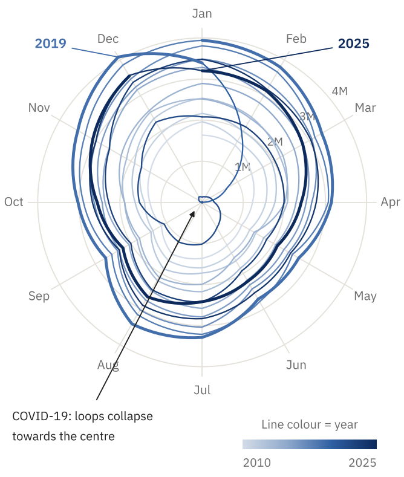
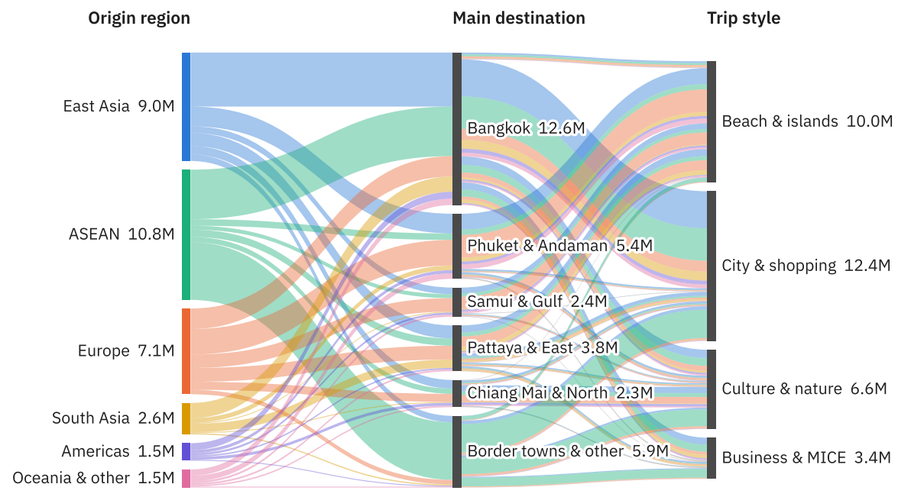
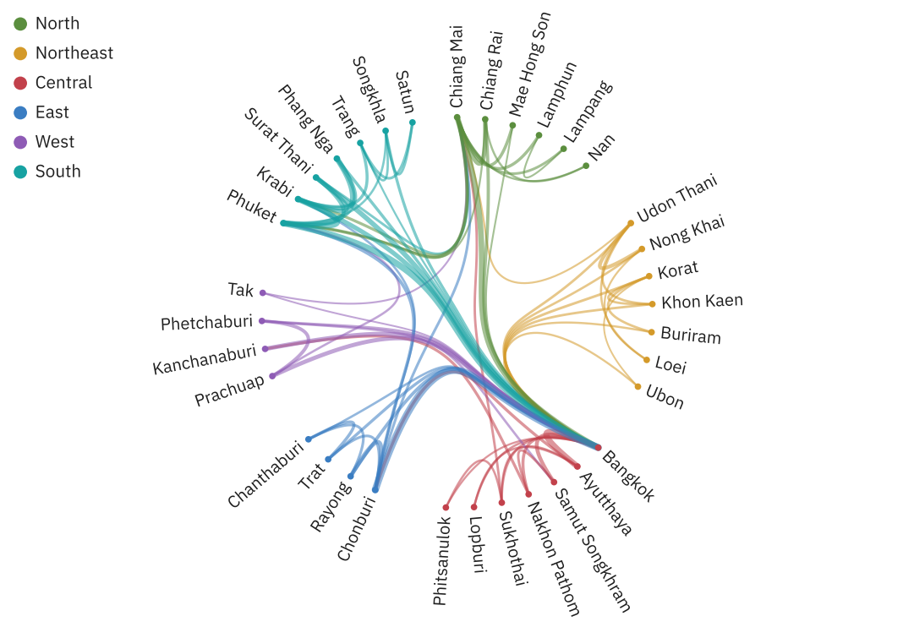
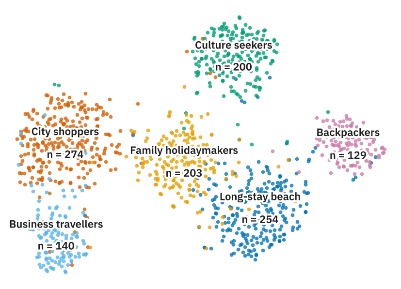

# Twelve Views of Thai Tourism

**Thanatchon Chongmankhong**

Code, synthetic data and manuscript for **"Twelve Views of Thai Tourism: A Data-Shape-Driven Framework for
Visual Analysis, Evaluated by Planted-Structure Recovery"** ([`paper.pdf`](paper.pdf)).

> **All data in this repository are synthetic.** They are generated to resemble broad, publicly known patterns
> of inbound tourism to Thailand (a December–January peak season, the collapse of arrivals in 2020–2021,
> revenue concentrated in a few destinations), but no value is an official statistic. Do not cite any number
> from this repository as a fact about Thai tourism.

## Overview

Tourism data come in many shapes: cyclical time series, multi-stage flows, hierarchies, networks and
multivariate profiles. This project maps four research questions to twelve visual idioms through the shape of
the data, and evaluates the framework with a simulation study in which known structure is *planted* in the
data and its recovery is measured.

| Research question | Views |
|---|---|
| RQ1 Who visits, and when? | Unit chart, radial spiral, streamgraph, ridgeline plot |
| RQ2 Where do visitors go? | Sankey diagram, chord diagram, hierarchical edge bundling |
| RQ3 Where does the money go? | Circle packing, sunburst, beeswarm |
| RQ4 What kinds of travellers are there? | Parallel coordinates, t-SNE embedding map |

Every number, table and figure in the paper is regenerated from source by a single command.

## Preview

| | |
|---|---|
|  |  |
|  |  |

## Quick start

```bash
git clone https://github.com/<username>/twelve-views-thai-tourism.git
cd twelve-views-thai-tourism
python -m pip install -r requirements.txt
bash scripts/get_fonts.sh      # optional: IBM Plex font for the figures (falls back to DejaVu Sans)
python run_all.py              # data -> metrics -> figures -> paper.pdf
```

Building the manuscript needs a TeX distribution with `pdflatex` and `bibtex` (for example TeX Live).
Without TeX, run the other steps on their own: `make data analysis figures`.

## arXiv submission

```bash
make arxiv        # or: python -m src.build_paper --arxiv
```

This writes `arxiv/arxiv-submission.zip`, a self-contained source bundle (manuscript, `preprint.sty`,
`main.bbl`, figures and generated tables) that compiles with `pdflatex` alone, as arXiv requires, and
`arxiv/metadata.txt` with the title, plain-text abstract, comments and suggested categories. The layout
is defined in `paper/preprint.sty`, an arXiv-style preprint package written for this project.

## Repository layout

```
├── run_all.py               one command: data -> metrics -> figures -> paper
├── Makefile                 make data | analysis | figures | paper | test
├── src/
│   ├── config.py            paths, random seed, study period
│   ├── labels.py            every category label in one place
│   ├── data_gen.py          the ten synthetic datasets (data-generating mechanisms)
│   ├── analysis.py          metrics, planted-structure recovery, LaTeX macros and tables
│   ├── style.py             fonts, palettes, figure sizes
│   ├── figures.py           the twelve figure functions
│   └── build_paper.py       pdflatex -> bibtex -> pdflatex
├── tests/test_pipeline.py   consistency and recovery checks (pytest)
├── data/                    generated CSVs + datasets.json (data dictionary)
├── figures/                 generated figures (PDF for the paper, PNG for previews)
├── results/metrics.json     every computed metric
├── paper/
│   ├── main.tex             manuscript source
│   ├── preprint.sty         arXiv-style layout
│   ├── references.bib       bibliography
│   └── generated/           numbers.tex and table bodies written by analysis.py
├── paper.pdf                compiled manuscript
├── arxiv/                   ready-to-upload arXiv bundle and form metadata
└── scripts/get_fonts.sh     downloads IBM Plex Sans Thai (SIL OFL)
```

## The twelve figures

| File | Idiom | Function in `src/figures.py` |
|---|---|---|
| `fig02_unit_chart` | Unit chart | `unit_chart` |
| `fig03_radial_spiral` | Radial spiral | `radial_spiral` |
| `fig04_streamgraph` | Streamgraph (wiggle baseline) | `streamgraph` |
| `fig05_ridgeline` | Ridgeline plot | `ridgeline` |
| `fig06_sankey` | Three-stage Sankey diagram | `sankey` |
| `fig07_chord` | Chord diagram | `chord` |
| `fig08_edge_bundling` | Hierarchical edge bundling | `edge_bundling` |
| `fig09_circle_packing` | Circle packing | `circle_packing` |
| `fig10_sunburst` | Sunburst | `sunburst` |
| `fig11_beeswarm` | Beeswarm (variable radius) | `beeswarm` |
| `fig12_parallel_coordinates` | Parallel coordinates | `parallel_coordinates` |
| `fig13_embedding` | t-SNE embedding map | `embedding` |

Redraw any subset with `python -m src.figures sankey chord`. Figure 1 (the framework diagram) is drawn in
TikZ inside `paper/main.tex`.

## Using real data

Replace the CSVs in `data/` with real data that have the same columns (listed in `data/datasets.json`), then
run `make analysis figures paper`. Numbers, tables and figures update automatically; the interpretive text in
`paper/main.tex` must be revised by hand.

## Tests

```bash
python -m pytest -q
```

The tests check, among other things, that monthly arrivals sum to annual totals, that the provincial revenue
identity holds, that generation is deterministic, and that the planted structure is recovered.

## Citation

See [`CITATION.cff`](CITATION.cff). Please cite the paper if you use the framework or the code.

## Licence and disclosure

Code is released under the MIT licence (see [`LICENSE`](LICENSE)). The IBM Plex fonts are downloaded
separately under the SIL Open Font License.

The manuscript and code were drafted with the help of a generative AI assistant (Claude, Anthropic). The
author is responsible for verifying all content, including every reference, before publication.
