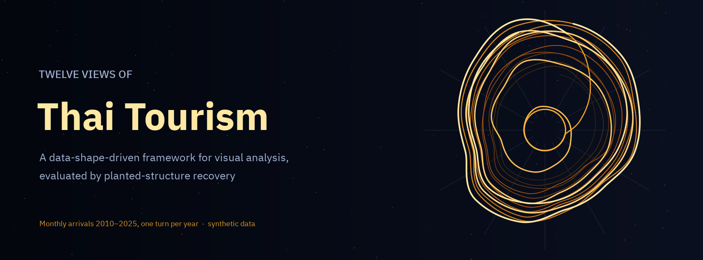
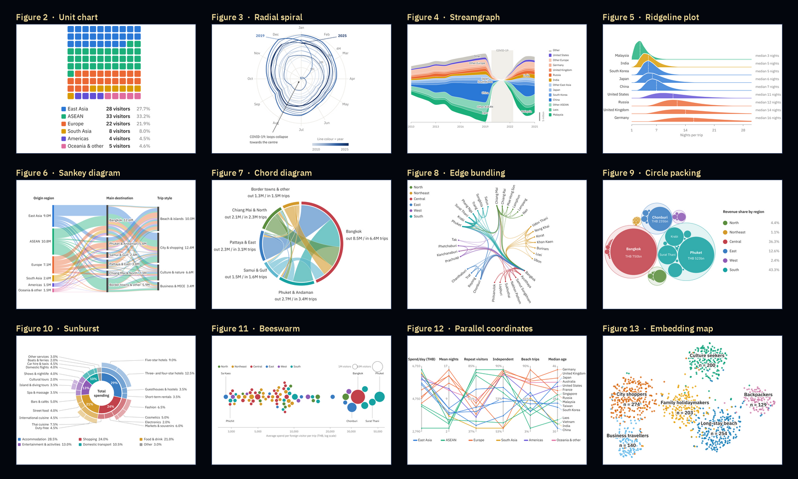
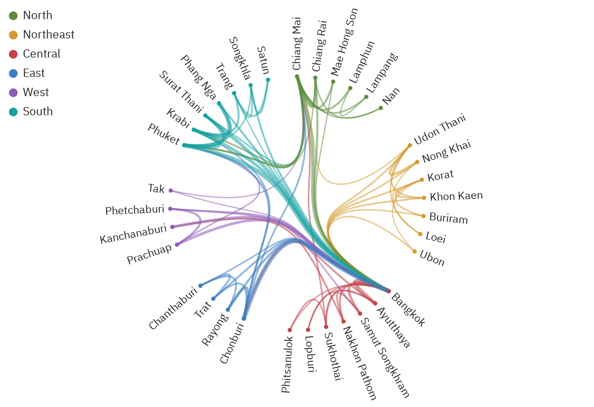

<p align="center"><a href="paper/paper.pdf"></a></p>

<p align="center">
<a href="https://github.com/thanatchon36/twelve-views-thai-tourism/actions/workflows/ci.yml"></a>
<a href="pyproject.toml"></a>
<a href="https://thanatchon36.github.io/twelve-views-thai-tourism/paper/"></a>
<a href="paper/paper.pdf"></a>
<a href="docs/data_sources.md"></a>
<a href="LICENSE"></a>
<a href="https://huggingface.co/datasets/thanatchon36/twelve-views-thai-tourism"></a>
</p>

<p align="center">
📖 <b><a href="https://thanatchon36.github.io/twelve-views-thai-tourism/paper/">Read the paper online</a></b> ·
📄 <b><a href="paper/paper.pdf">Download the PDF</a></b> ·
🗂️ <b><a href="docs/data_sources.md">Data sources</a></b> ·
🤗 <b><a href="https://huggingface.co/datasets/thanatchon36/twelve-views-thai-tourism">Dataset</a></b>
</p>

**A data-shape-driven framework for the visual analysis of inbound tourism to Thailand.** Four research
questions are mapped, through the shape of the data each one needs, to twelve coordinated views: unit chart,
radial spiral, streamgraph, ridgeline plot, Sankey and chord diagrams, hierarchical edge bundling, circle packing,
sunburst, beeswarm, parallel coordinates and a t-SNE embedding map. The framework is evaluated by a simulation
study in which known structure is planted in ten synthetic datasets and each view's companion statistic is scored
on how well it recovers it.



> **Synthetic data notice.** Every file in `data/raw/` is a `synthetic_*.csv` test file, generated to resemble
> broad, publicly known patterns of inbound tourism to Thailand (a December–January high season, the collapse of
> arrivals in 2020–2021, revenue concentrated in a few destinations). No value is an official statistic, and
> nothing computed from them is a fact about Thai tourism. The loader uses a real `data/raw/<name>.csv` whenever
> one is present and warns every run that it falls back to synthetic data. `docs/data_sources.md` is the shopping
> list for the real files; drop them in and run `make all`.

## Install and quickstart

```bash
make setup      # uv venv + dependencies (Python 3.12)
make fonts      # optional: IBM Plex Sans Thai for the figures (falls back to DejaVu Sans)
make all        # analysis -> figures -> paper + web reader   (about a minute)
make test       # 10 tests: data identities, determinism, planted-structure recovery
```

Outputs: `data/processed/metrics.json` (every computed metric), `paper/tables/` (LaTeX macros and table bodies),
`paper/figures/` (PDF for the paper, PNG for the web), `paper/paper.pdf` and the web reader `docs/paper/`.

| Target | Purpose |
|---|---|
| `synthetic` | (Re)generate the ten synthetic datasets. Never a substitute for real data |
| `analysis` | Every number in the paper and the planted-structure recovery → `data/processed/`, `paper/tables/` |
| `figures` | The twelve figures → `paper/figures/` (`python -m twelveviews.cli figures sankey chord` for a subset) |
| `paper` | Build `paper/paper.pdf` (tectonic) and the web reader `docs/paper/` (pandoc) |
| `web` | Web reader only → `docs/paper/index.html`, served at <https://thanatchon36.github.io/twelve-views-thai-tourism/paper/> |
| `arxiv` | arXiv source bundle → `paper/arxiv.tar.gz` (prints title, abstract and comments for the form) |
| `assets` | README banner and preview → `docs/assets/` |

Building the paper needs [tectonic](https://tectonic-typesetting.github.io/) (`brew install tectonic`); the web
reader also needs pandoc and `pdftoppm` (poppler).

## What the pipeline does

1. **Synthetic data with planted structure** (`twelveviews.data_gen`): ten datasets from one seed (2026), each from
   its own random stream: arrivals for ten markets and seven residual groups, 2010–2025, with a pandemic collapse
   and recovery; monthly allocation through a planted seasonal profile; log-normal lengths of stay; origin →
   destination → trip-style flows; onward travel between six destination clusters; 77 provinces with visitors,
   spend and revenue; co-visitation; a three-level spending hierarchy; and a survey of 1,200 respondents drawn
   from six latent personas.
2. **Loader** (`twelveviews.loaders`): real `data/raw/<name>.csv` first, `synthetic_<name>.csv` otherwise, with a
   warning.
3. **Analysis** (`twelveviews.analysis`): concentration (HHI, Gini), seasonality, market shifts, network and
   segment statistics, and recovery of each planted estimand (E1–E8): seasonal profile, depth of the shock,
   length-of-stay medians, destination preferences, the Bangkok hub and persona membership. Every number is
   written as a LaTeX macro and every table body as a file, so the paper is regenerated from the data.
4. **Figures** (`twelveviews.figures`): one Matplotlib function per view; idioms that standard libraries lack
   (chord layout, hierarchical edge bundling, variable-radius beeswarm) are implemented here.
5. **Paper** (`twelveviews.paper_build`, `twelveviews.paper_web`): `paper/paper.tex` typeset with tectonic, and
   the same source rendered by pandoc into a web reader with a results strip read from `metrics.json`.

## Research: *Twelve Views of Thai Tourism: A Data-Shape-Driven Framework for Visual Analysis, Evaluated by Planted-Structure Recovery*

The working paper by Thanatchon Chongmankhong is in [`paper/`](paper/): a PDF in [`paper/paper.pdf`](paper/paper.pdf),
its LaTeX source in [`paper/paper.tex`](paper/paper.tex) and the web version at
<https://thanatchon36.github.io/twelve-views-thai-tourism/paper/>. `make arxiv` packs the source with its tables,
figures and bibliography into `paper/arxiv.tar.gz` and checks the bundle compiles on its own. The paper asks
which visual idiom fits which tourism question, and whether each view actually reveals the structure it is meant
to reveal. On the synthetic data the views recover the seasonal profile (r = 0.998), median length of stay
(mean absolute error 0.32 nights), destination preferences (0.37 percentage points) and persona membership
(adjusted Rand index 0.85).

| Research question | Views |
|---|---|
| RQ1 Who visits, and when? | Unit chart, radial spiral, streamgraph, ridgeline plot |
| RQ2 Where do visitors go? | Sankey diagram, chord diagram, hierarchical edge bundling |
| RQ3 Where does the money go? | Circle packing, sunburst, beeswarm |
| RQ4 What kinds of travellers are there? | Parallel coordinates, t-SNE embedding map |

- Tables: [`paper/tables/`](paper/tables/) · Figures: [`paper/figures/`](paper/figures/)
- Dataset on Hugging Face: [`thanatchon36/twelve-views-thai-tourism`](https://huggingface.co/datasets/thanatchon36/twelve-views-thai-tourism),
  with the eleven synthetic tables, the manifest and the computed metrics

<p align="center"></p>

## Repository layout

```
src/twelveviews/
  config.py                 paths, seed, study period
  labels.py                 every category label in one place
  data_gen.py               the ten synthetic datasets (data-generating mechanisms)
  loaders.py                real file first, synthetic fallback with a warning
  analysis.py               metrics, planted-structure recovery, LaTeX macros and tables
  style.py                  fonts, palettes, figure sizes
  figures.py                the twelve figure functions
  paper_build.py            paper.tex -> paper.pdf (tectonic)
  paper_web.py              paper.tex -> docs/paper/ web reader (pandoc)
  cli.py                    python -m twelveviews.cli {synthetic,analysis,figures,paper,web}
data/raw/                   synthetic_*.csv, synthetic_manifest.json, SYNTHETIC_README.txt
paper/                      paper.tex, references.bib, reader.html, tables/, figures/, paper.pdf
docs/                       GitHub Pages: paper/ (web reader), assets/, data_sources.md
scripts/arxiv_bundle.py     arXiv source bundle
scripts/make_assets.py      README banner and preview
scripts/get_fonts.sh        IBM Plex Sans Thai (SIL OFL)
tests/                      consistency and recovery checks
```

## Going from synthetic to real

1. Fetch the sources in `docs/data_sources.md` and save them as `data/raw/<dataset>.csv` with the same columns
   (any subset works; missing ones fall back to synthetic with a warning).
2. Recovery statistics (E1–E8) compare against planted values and are only defined on synthetic data; with real
   data, report the companion statistics themselves.
3. `make all`. Numbers, tables and figures update; the interpretive text in `paper/paper.tex` must be revised
   by hand.

## Limitations
Synthetic data, so the results demonstrate the method and say nothing about Thai tourism; static views, although
parallel coordinates and circle packing in particular would gain from brushing and zooming; no display of
uncertainty in the underlying estimates; and t-SNE depends on its hyperparameters and initialisation (its
coordinates also vary slightly across platforms). See paper §6.4–6.5.

## Citation
See [`CITATION.cff`](CITATION.cff). License: MIT (code); the IBM Plex fonts are downloaded separately under the SIL
Open Font License.

The manuscript and code were drafted with the help of a generative AI assistant (Claude, Anthropic). The author is
responsible for verifying all content, including every reference, before publication.
